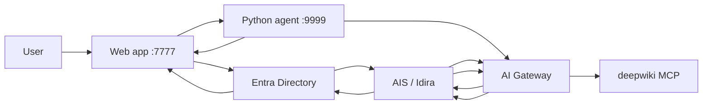

# AIS Client

Local demo of a signed-in web app calling the deepwiki MCP server through the AI Gateway. Two processes run side by side, and each one has its own sign-in.

| Process | File | Address |
|---|---|---|
| Web app | `frontend.py` | http://localhost:7777 |
| Python agent | `test_ais_tinytot.py` | http://localhost:9999 |

The web app signs the user in with Microsoft Entra ID. The Python agent calls `https://mcp-aigw.portkey.ai/deepwikimcp/mcp` with a token issued by the AI Gateway. That gateway token is obtained through AIS/Idira, which authenticates the user with Entra Directory and then authorizes the MCP call.



## Two credentials

The browser holds two different tokens. They are not interchangeable.

| | Web app session | MCP call |
|---|---|---|
| Who issues it | Entra Directory | AI Gateway |
| Client | `AIS_ENTRA_CLIENT_ID` | `AIS_CLIENT_ID` |
| Redirect | `http://localhost:7777/callback` | `http://localhost:9999/callback` |
| Scopes | `openid profile email` | Gateway MCP scopes (`mcp:*` and the scopes advertised by deepwiki) |
| Who consumes it | The web app, to show the signed-in user | deepwiki, as `Authorization: Bearer` |
| Lifetime in this demo | In-memory session cookie `ais_session` | Access token about 1 hour, plus a refresh token, kept in the agent process |

Signing in to the web app does not sign the user in to the gateway. Sharing the same Entra directory lets AIS/Idira federate the second sign-in, so the user may not type a second password, and the gateway still runs its own authorize redirect and still issues its own token.

## 1. Web app sign-in

`./start.sh` opens http://localhost:7777. The signed-out page shows the Entra client id and `http://localhost:7777/callback`. **Sign in** goes to `/login`.

1. The web app creates a PKCE S256 verifier and a nonce, then redirects the browser to the tenant authorize endpoint:

   `https://login.microsoftonline.com/{AIS_ENTRA_TENANT}/oauth2/v2.0/authorize`

   The request is an authorization-code grant with `prompt=select_account`. The tenant is specific. This app is single-tenant, so the `/common` endpoint is not used.

2. The user signs in at Entra Directory. Entra redirects the browser to `http://localhost:7777/callback` with an authorization code.

3. The web app exchanges that code at the tenant token endpoint. The exchange sends the client id, the PKCE verifier, and the redirect URI. It does not send a client secret, so the Entra app registration must be a public client.

4. The web app checks the `nonce` in the ID token, then stores `preferred_username`, `name`, `oid`, `tid`, and the Entra access token in memory. The browser receives an `HttpOnly` `SameSite=Lax` session cookie and returns to the home page.

The signed-in page shows the gateway client id and `http://localhost:9999/callback`. **Call Python Agent** is a link to `http://localhost:9999/run`. The Entra access token stays in the web app session. It is not posted to the agent and it is not sent to deepwiki.

## 2. Python agent and the AI Gateway

`GET /run` chooses one of three paths.

### Saved access token

When the agent already has a gateway access token and it is more than 60 seconds from expiry, the agent calls deepwiki immediately. The browser does not visit AIS/Idira or Entra again. The Flow tab draws the authentication and authorization arrows in gray and captions them as skipped.

### Refresh token

When the access token is missing or inside that 60-second window, and a refresh token is still stored, the agent posts a `refresh_token` grant to the gateway token endpoint. The form contains `client_id` and `resource`. It does not contain a client secret. A new access token is stored, including a rotated refresh token when the gateway returns one, and deepwiki is called. This hop is silent.

### New gateway authorization

When there is no usable token, the agent discovers the gateway and sends the browser through AIS/Idira.

1. **Discover.** The agent `POST`s `initialize` to the deepwiki MCP URL with no bearer token. The gateway answers HTTP 401 and a `WWW-Authenticate` header whose `resource_metadata` URL points at the protected-resource metadata. That 401 is the discovery signal.

2. **Protected-resource metadata.** `GET https://mcp-aigw.portkey.ai/.well-known/oauth-protected-resource/deepwikimcp/mcp` returns the resource URL and `authorization_servers`.

3. **Authorization-server metadata.** `GET https://mcp-aigw.portkey.ai/.well-known/oauth-authorization-server/deepwikimcp/mcp` returns `authorization_endpoint` and `token_endpoint`. For this server those are `https://mcp-aigw.portkey.ai/oauth/deepwikimcp/authorize` and `https://mcp-aigw.portkey.ai/oauth/token`. The token endpoint accepts public clients (`token_endpoint_auth_methods_supported` includes `none`).

4. **Authorize.** The agent redirects the browser to the discovered authorize URL with the gateway client id, PKCE S256, `redirect_uri=http://localhost:9999/callback`, the MCP scopes, and `resource` set to the deepwiki MCP URL.

5. **Authenticate.** The gateway sends the browser to AIS/Idira. AIS/Idira sends the user to Entra Directory. Entra authenticates the user and returns that result to AIS/Idira. AIS/Idira confirms the authenticated user to the gateway. When Idira is federated to the same directory as the web app, this step can reuse the Entra session.

6. **Authorize the MCP call.** The gateway asks AIS/Idira to authorize the agent for the MCP call. AIS/Idira authorizes it. The gateway then redirects the browser to `http://localhost:9999/callback` with an authorization code.

7. **Token.** The agent exchanges the code at the gateway token endpoint with the PKCE verifier, client id, redirect URI, and resource. No client secret is sent. The response is an opaque gateway access token, a refresh token, `expires_in` (3600 seconds in the runs so far), and scope `mcp:*`. The agent keeps both tokens in memory.

8. **MCP.** The agent calls deepwiki with that bearer token: `initialize`, `tools/list`, then one `tools/call` (`ask_wiki_question` against `facebook/react` when that tool is listed). The `Mcp-Session-Id` from `initialize` is sent on the later calls. Protocol version is `2025-03-26`.

9. **Result.** The agent stores the redacted call log and redirects the browser to `http://localhost:7777/called?rid=...`. The web app reads the log from `http://127.0.0.1:9999/results/{id}` and renders it. Result and trace endpoints accept loopback clients only.

Restarting the agent drops the in-memory token. The next **Call Python Agent** runs the full AIS/Idira approval again.

## Flow tab

http://localhost:7777/flow polls `/flow/live` once a second. The page animates the chronology:

1. User opens the web app.
2. Web app sends the user to Entra Directory.
3. Entra returns the user token to the web app.
4. Web app calls the Python agent.
5. Agent reaches the AI Gateway, or reuses the saved gateway token.
6. For a new token: AIGW authenticates through AIS/Idira and Entra Directory, then AIS/Idira authorizes the MCP call and AIGW issues the token.
7. AIGW calls the MCP server.
8. The result returns to the web app.

On a saved-token call, step 6 is still drawn so the authentication and authorization path stays visible, and the caption says that hop was not repeated.

## Entra app registration

Register the web app in the same directory the demo uses (`AIS_ENTRA_TENANT`, default `oogwaysanhotmail.onmicrosoft.com`):

- Single-tenant app.
- Platform **Mobile and desktop applications**, redirect URI `http://localhost:7777/callback`.
- **Allow public client flows** enabled.
- No client secret. A confidential **Web** registration makes the token exchange fail because this process redeems the code with PKCE only.

The gateway client is separate. Its redirect URI is `http://localhost:9999/callback`, and it stays the value of `AIS_CLIENT_ID`. Registering the web app in Entra does not make the gateway accept the Entra access token.

## Run

```bash
./start.sh
# open http://localhost:7777
./stop.sh
```

`start.sh` exports these defaults. A gitignored `.env` can override them.

| Variable | Purpose |
|---|---|
| `AIS_ENTRA_TENANT` | Entra tenant for the web app authorize and token URLs |
| `AIS_ENTRA_CLIENT_ID` | Public client id of the web app |
| `AIS_ENTRA_REDIRECT_URI` | Must stay `http://localhost:7777/callback` |
| `AIS_CLIENT_ID` | Public client id of the AI Gateway app |
| `AIS_REDIRECT_URI` | Must stay `http://localhost:9999/callback` |
| `AIS_FRONTEND_URL` | Must stay `http://localhost:7777` |
| `AIS_GATEWAY` | Gateway origin, default `https://mcp-aigw.portkey.ai` |
| `AIS_DEEPWIKI_SLUG` | MCP server slug, default `deepwikimcp` |
| `AIS_AGENT_NAME` | Name sent in the MCP `initialize` request |

Logs go to `.run/agent.log` and `.run/frontend.log`. Token values are redacted before they are written to those logs or shown on the page.

## Other notes

`canvases/portkey-mcp-oauth-flow.md` compares three AI Gateway MCP setups (gateway plus IdP, CIE, and AIS) across Claude Code, Codex, and GitHub Copilot. This demo is the local web app and Python agent path for gateway authentication through AIS/Idira.
